<picture><source media="(prefers-color-scheme: dark)" srcset="assets/hero-dark.svg">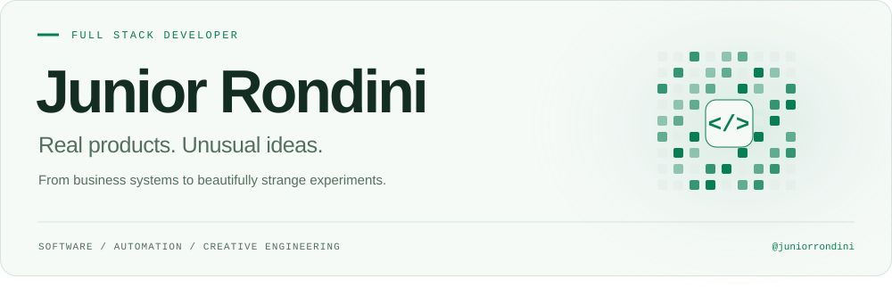</picture>

  <picture><source media="(prefers-color-scheme: dark)" srcset="assets/roles-dark.svg"></picture>

  <a href="https://www.linkedin.com/in/juniorrondini"><picture><source media="(prefers-color-scheme: dark)" srcset="assets/social-linkedin-dark.svg"></picture></a>
  <a href="mailto:jjrondinijj@gmail.com"><picture><source media="(prefers-color-scheme: dark)" srcset="assets/social-email-dark.svg"></picture></a>
  <a href="https://github.com/juniorrondini"><picture><source media="(prefers-color-scheme: dark)" srcset="assets/social-github-dark.svg"></picture></a>

  <a href="#-about-me">About</a> &nbsp; / &nbsp;
  <a href="#-tech-universe">Tech universe</a> &nbsp; / &nbsp;
  <a href="#-featured-projects">Projects</a> &nbsp; / &nbsp;
  <a href="#-github-in-motion">GitHub</a> &nbsp; / &nbsp;
  <a href="#-the-commit-signature">Commit snake</a>

<picture><source media="(prefers-color-scheme: dark)" srcset="assets/divider-dark.svg"></picture>

## 💻 About me

  <picture><source media="(prefers-color-scheme: dark)" srcset="assets/terminal-dark.svg">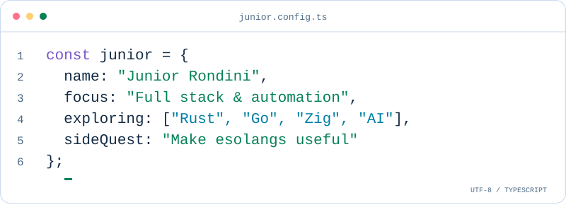</picture>

I build **interfaces, APIs, databases and automation** — software that solves real business problems, with room for experiments that make programming fun.

- **Building:** full stack applications, business systems and useful developer tools.
- **Exploring:** performance, AI integrations and SaaS products.
- **Side quests:** unusual languages, retro software and wonderfully cursed ideas.

<picture><source media="(prefers-color-scheme: dark)" srcset="assets/divider-dark.svg"></picture>

## 🛠 Tech universe

### Frontend

  
  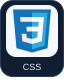
  
  
  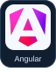
  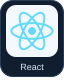
  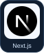
  
  
  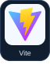

### Backend

  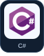
  
  
  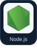
  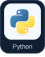
  
  
  

### Data & storage

  
  
  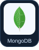
  
  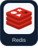
  

### Cloud, DevOps & tools

  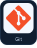
  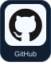
  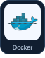
  
  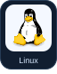
  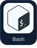
  
  
  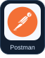
  

### Mobile, desktop & engines

  
  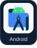
  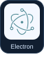
  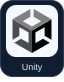

### Beyond the comfort zone

  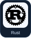
  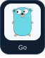
  
  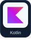
  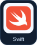
  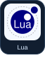
  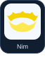
  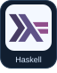

**Also exploring:** Prolog · Forth · COBOL · Fortran · Pascal · Lisp · Crystal

<strong>Enter the esolang rabbit hole</strong> 🧪

  <a href="https://github.com/juniorrondini/Esoteric-Suite/tree/main/brainfuck-api"><code>Brainfuck</code></a> &nbsp; <a href="https://github.com/juniorrondini/Esoteric-Suite/tree/main/lolcode-todo"><code>LOLCODE</code></a> &nbsp; <a href="https://github.com/juniorrondini/Esoteric-Suite/tree/main/rockstar-tax"><code>Rockstar</code></a> &nbsp; <a href="https://github.com/juniorrondini/Esoteric-Suite/tree/main/whitespace-vault"><code>Whitespace</code></a> &nbsp; <a href="https://github.com/juniorrondini/Esoteric-Suite/tree/main/chef-recipe-calc"><code>Chef</code></a> &nbsp; <a href="https://github.com/juniorrondini/Esoteric-Suite/tree/main/befunge-maze"><code>Befunge</code></a> &nbsp; <a href="https://github.com/juniorrondini/Esoteric-Suite/tree/main/arnold-motivator"><code>ArnoldC</code></a> &nbsp; <a href="https://github.com/juniorrondini/Esoteric-Suite/tree/main/esolang-zoo/piet-pixel-art"><code>Piet</code></a>

From Brainfuck API responses to recipe-shaped code, [Esoteric Suite](https://github.com/juniorrondini/Esoteric-Suite) is where these experiments live.

<picture><source media="(prefers-color-scheme: dark)" srcset="assets/divider-dark.svg"></picture>

## 🚀 Featured projects

  <a href="https://github.com/juniorrondini/Zentinel"><picture><source media="(prefers-color-scheme: dark)" srcset="assets/project-zentinel-dark.svg"></picture></a>
  <a href="https://github.com/juniorrondini/whisper"><picture><source media="(prefers-color-scheme: dark)" srcset="assets/project-whisper-dark.svg"></picture></a>
  <a href="https://github.com/juniorrondini/Esoteric-Suite"><picture><source media="(prefers-color-scheme: dark)" srcset="assets/project-esoteric-dark.svg"></picture></a>
  <a href="https://github.com/juniorrondini/LedgerFox"><picture><source media="(prefers-color-scheme: dark)" srcset="assets/project-ledgerfox-dark.svg"></picture></a>

<a href="https://github.com/juniorrondini?tab=repositories"><strong>Explore all repositories →</strong></a>

<picture><source media="(prefers-color-scheme: dark)" srcset="assets/divider-dark.svg"></picture>

## 📊 GitHub in motion

  <picture><source media="(prefers-color-scheme: dark)" srcset="assets/github-stats-dark.svg">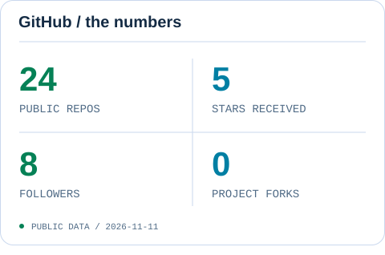</picture>
  <picture><source media="(prefers-color-scheme: dark)" srcset="assets/language-stats-dark.svg">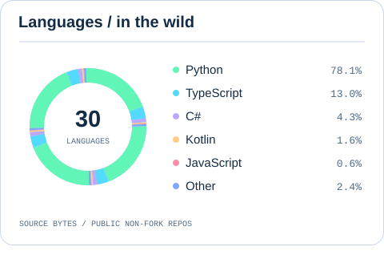</picture>

Daily public GitHub snapshot. Language composition uses source bytes from public, non-fork repositories.

## 🐍 The commit signature

<picture><source media="(prefers-color-scheme: dark)" srcset="assets/commit-snake-dark.svg"></picture>

A custom pixel signature inspired by the contribution graph.

<picture><source media="(prefers-color-scheme: dark)" srcset="assets/footer-dark.svg"></picture>

  <a href="mailto:jjrondinijj@gmail.com"><strong>Let's build something →</strong></a> 
  Junior Rondini &nbsp; / &nbsp; jjrondinijj@gmail.com

